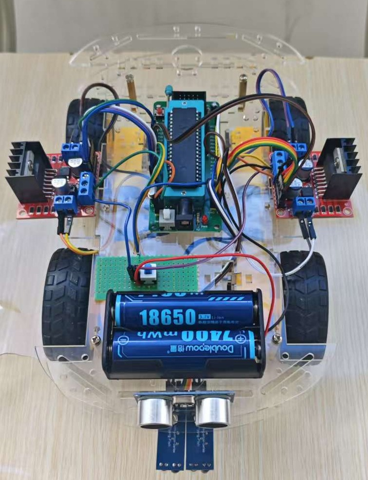
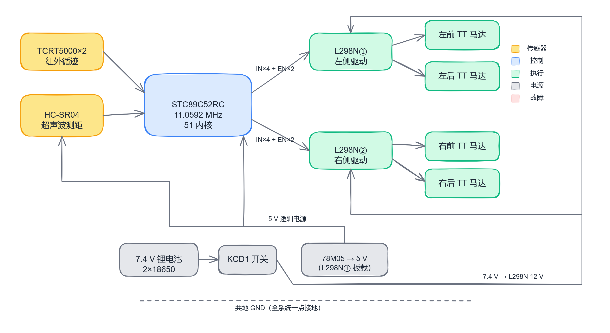
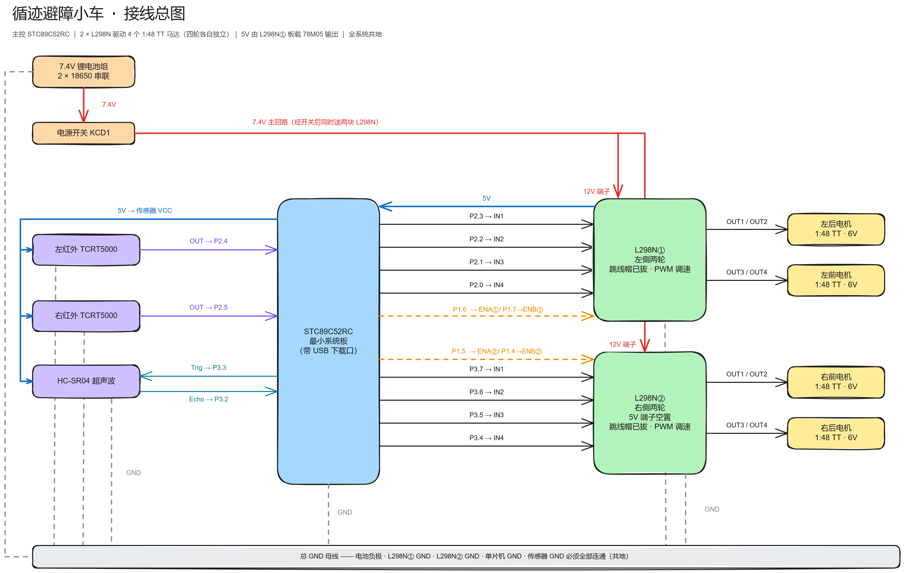
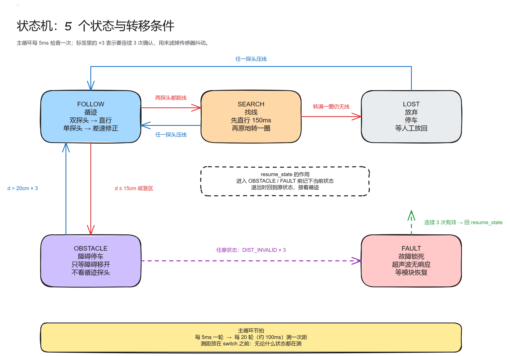

# 51 循迹避障小车

基于 STC89C52RC 单片机的四轮循迹避障小车：两路 TCRT5000 红外传感器循黑线行驶，HC-SR04 超声波测距，遇障碍自动停车，障碍解除后原地扫描找回黑线继续行驶。四个 TT 减速电机由两块 L298N 独立驱动，四路软件 PWM 分别调速。



## 功能特性

- **红外循迹**：左右两路 TCRT5000 沿黑线行驶，丢线后先直行救回断口 / 十字路口，再原地扫描 360° 找线
- **超声波避障**：100 ms 周期测距，障碍 15 cm 内停车，退到 20 cm 外并连续 3 次确认后恢复循迹
- **四轮独立 PWM**：Timer1 中断实现的 20 级软件 PWM（约 250 Hz），转向时内外轮差速，转弯更顺
- **可靠性设计**：测距三确认防抖、超声波故障自动恢复、丢线超时处理、循迹极性可配置

## 系统组成



## 硬件清单

| 器件 | 型号 / 规格 | 数量 |
|---|---|:--:|
| 单片机最小系统板 | STC89C52RC（带 USB 下载口） | 1 |
| 电机驱动模块 | L298N 双路 H 桥 | 2 |
| 红外循迹模块 | TCRT5000（三针，数字输出） | 2 |
| 超声波模块 | HC-SR04 | 1 |
| 直流减速电机 | 1:48 双轴 TT 马达 | 4 |
| 电源 | 18650 锂电池 ×2 串联（7.4V） | 1 |
| 底盘 | 4WD 双层亚克力底盘 | 1 |

完整采购清单、供电链路（5V 由 L298N 板载稳压输出给单片机）与接线细节见 [硬件清单与接线文档](docs/循迹避障小车硬件清单与接线文档_整理版.md)。

## 接线概要

| 51 引脚 | 接往 | 功能 |
|---|---|---|
| P2.3 → P2.0 | L298N① IN1 → IN4 | 电机① 方向控制 |
| P3.7 → P3.4 | L298N② IN1 → IN4 | 电机② 方向控制 |
| P1.4 ~ P1.7 | 两块 L298N 的 ENA / ENB | 四路独立 PWM 调速 |
| P2.4 / P2.5 | 左 / 右 TCRT5000 OUT | 红外循迹（黑线 = 1） |
| P3.3 / P3.2 | HC-SR04 Trig / Echo | 超声波测距 |



> **注意**：L298N 的 ENA/ENB 跳线帽必须拔掉（PWM 信号要与板载 5V 上拉断开），每个电机的轮位对应关系、真值表与供电细节以[接线文档](docs/循迹避障小车硬件清单与接线文档_整理版.md)为准。

## 快速开始

1. **接线**：按[接线文档](docs/循迹避障小车硬件清单与接线文档_整理版.md)连接各模块；模块资料（L298N / HC-SR04 / TCRT5000 的引脚、时序与实测数据）见[驱动模块参考资料](docs/循迹小车主要驱动模块参考资料.md)。
2. **编译**：用 Keil C51 新建工程，芯片选 AT89C52（与 STC89C52RC 兼容），晶振频率填 `11.0592`，在 Target 选项里把 Xtal 设为 11.0592MHz，Output 页勾选 **Create HEX File**，把 `firmware/ZHIXINCS.c` 加入工程编译。
   - 源码为 **UTF-8 编码**：Keil 里请在 `Edit → Configuration → Editor → Encoding` 选择 UTF-8，否则中文注释乱码；或把文件另存为 ANSI（GBK）编码。
3. **烧录**：用 STC-ISP 下载 HEX 文件。

> ⚠️ **烧录时时钟模式必须选 12T**（STC-ISP 里的选项，代码无法控制）。误选 6T 会导致：主循环快一倍、PWM 频率翻倍、测距读数翻倍——表现为 15cm 停车阈值实际 7.5cm 才触发，看着正常直到撞墙。换芯片或换电脑烧录后请先核对这一项。

## 程序说明

程序为前后台结构：主循环（`main`）负责循迹决策与状态机，`timer1_isr` 中断负责软件 PWM 输出，核心功能集中在 `measure_cm`（超声波测距）与 `line_follow_step`（单步循迹）两个函数。主控状态机共 5 个状态：循迹（FOLLOW）、找线（SEARCH）、放弃（LOST）、障碍停车（OBSTACLE）、故障锁死（FAULT）。



| 项目 | 设定值 |
|---|---|
| 主控 / 晶振 | STC89C52RC / 11.0592MHz，12T |
| PWM | Timer1 方式 2 自动重装，20 级，约 250Hz，分辨率 5% |
| 巡航占空比 | 35%（转向时外轮 40% / 内轮 25% / 原地转向 35%） |
| 测距周期 | 100 ms |
| 停车 / 恢复阈值 | 15 cm / 20 cm，连续 3 次确认防抖 |
| 丢线处理 | 先直行 150 ms 救线，再原地扫描约 4.8 s 找线 |
| 循迹极性 | 黑线 = 1（传感器批次相反时改 `LINE_BLACK_LEVEL`） |

调参提示：占空比不等于转速百分比——TT 马达有启动死区，20% 以下常常转不动，25% 已接近能稳定转动的下限。若内侧轮 25% 不转，把 `INNER_DUTY` 提到 30%；整车起步困难则把 `CRUISE_DUTY` 提到 40%。各参数含义与计算依据（机器周期、PWM 频率、距离换算公式）见 `firmware/ZHIXINCS.c` 文件头注释。

## 目录结构

```
├── firmware/
│   └── ZHIXINCS.c            # 主程序（循迹 + 超声波避障，UTF-8 注释版）
├── docs/
│   ├── figures/               # 系统框图 / 接线总图 / 状态机转移图
│   ├── 循迹避障小车硬件清单与接线文档_整理版.md
│   ├── 循迹小车主要驱动模块参考资料.md
│   └── 驱动模块配图/          # L298N / HC-SR04 / TCRT5000 实物与引脚图
├── LICENSE                    # MIT
└── README.md
```

## License

本项目以 [MIT License](LICENSE) 开源。
