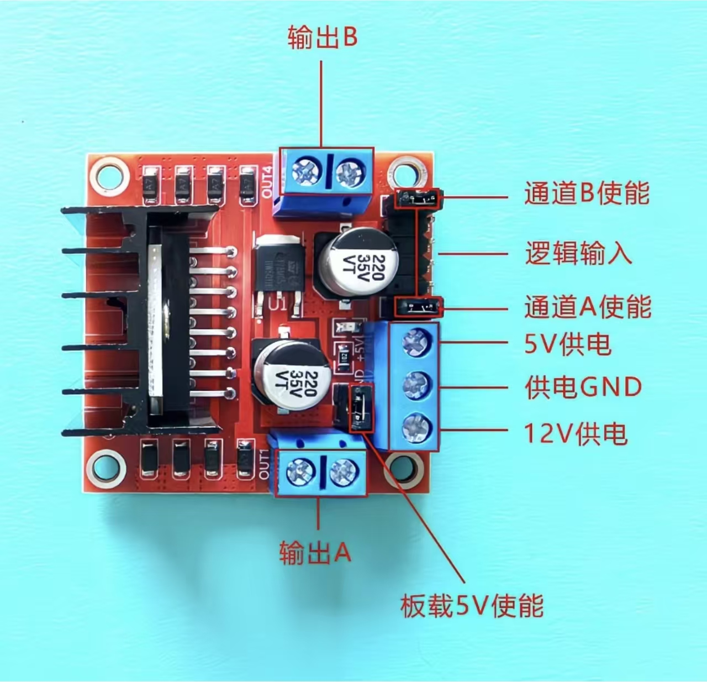
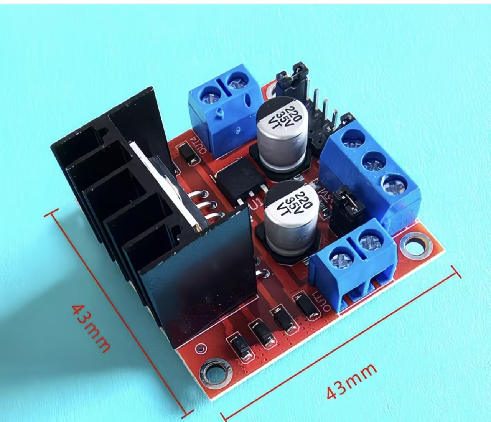
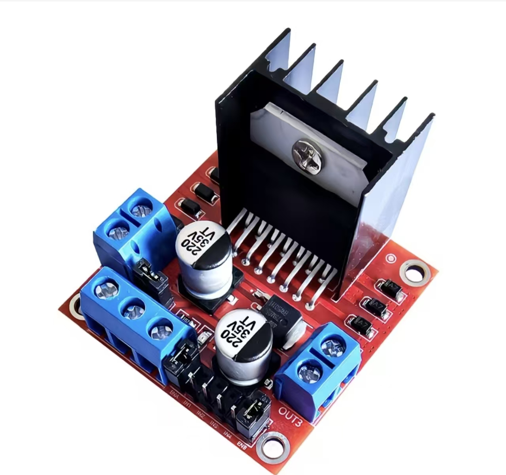
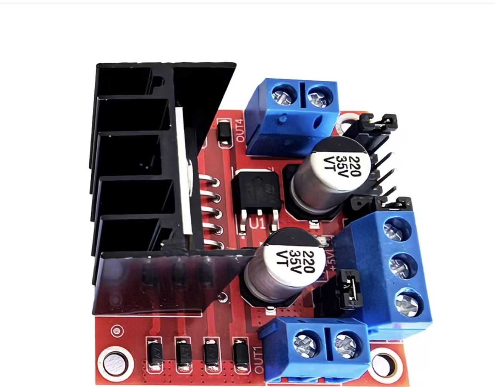
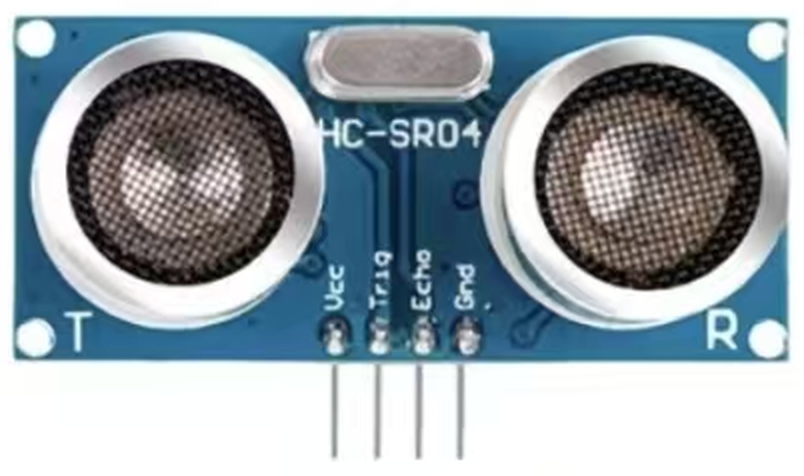
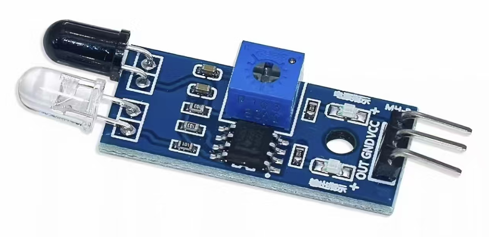
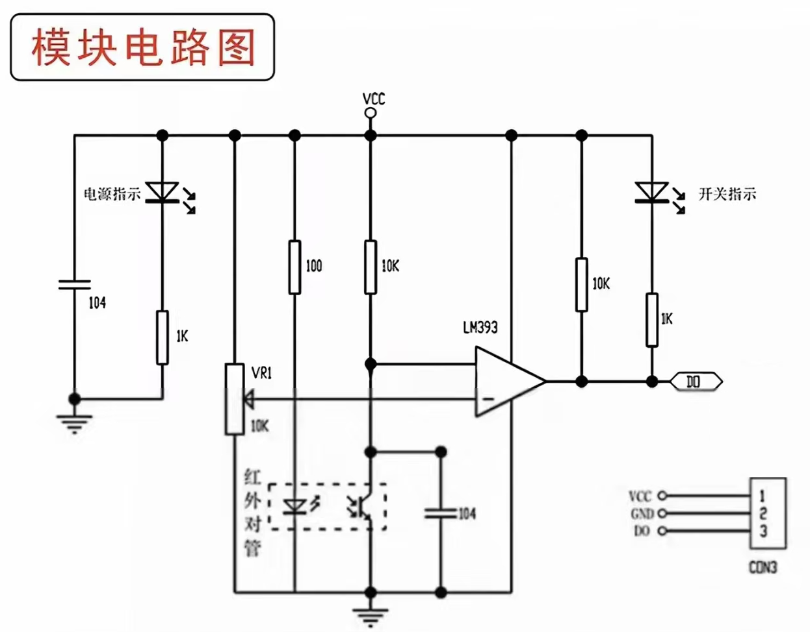

# 循迹小车主要驱动模块参考资料

> **素材来源**：同事微信发来的商品页面截图，共 10 张（前 7 张为 2026-10-13 收到，红外循迹模块 3 张为 2026-10-14 补发）。
>
> **整理方式**：各模块介绍文案按截图内容提取，未做改写或精简；原文中的错别字、乱码、脱字与衍字已按语义在正文中直接订正，标点习惯保留原样，逐条对照见文末「原文订正记录」。
>
> **整理者补充内容**（单独成节、标题即标明来源，不与截图原文混排）：第一章「6. 实测记录（2026-10-16、2026-10-17）」为实测数据；第一章「7. 使能端（ENA / ENB）…」与第二章「5. 工作方式与信号时序」为整理者注。
>
> **配图**：从截图中裁剪的模块图片存放于 `驱动模块配图/` 目录。
>
> **覆盖范围**：① L298N 电机驱动模块 ② HC-SR04 超声波测距模块 ③ 红外寻迹-循迹-避障传感器模块。

---

## 一、L298N 电机驱动模块

### 1. 产品特点（截图原文）

> 本模块使用L298N作为主驱动芯片，具有驱动能力强，发热量低，抗干扰能力强的特点。该芯片采用15脚封装。主要特点是:工作电压高，工作电压可高达46V;输出电流大，瞬间峰值电流可达3A，持续工作电流为2A;额定功率25W。内含两个H桥的高电压大电流全桥式驱动器，可以用来驱动直流电动机和步进电动机、继电器线圈等感性负载;采用标准逻辑电平信号控制;具有两个使能控制端，在不受输入信号影响的情况下允许或禁止器件工作有一个逻辑电源输入端，使内部逻辑电路部分在低电压下工作;可以外接检测电阻，将变化量反馈给控制电路。

### 2. 产品详情 · 技术参数（截图原文）

```
主控芯片:L298N
工作模式:H桥驱动(双路)
逻辑电压:5V-7V
逻辑电流:0-36mA
驱动电压: 5-35V,如需要板内取电,则供电范围7V-35V
驱动电流:2A(MAX单桥)
存储温度:-20°C到+135°C
最大功率:25W
控制信号输入电压范围:低电平:- 0.3V≤Vin≤1.5V
高电平:2.3V≤Vin≤Vss
使能信号输入电压范围:低电平:-0.3V≤Vin≤1.5V(控制信号无效)
高电平:2.3V≤Vin≤Vss(控制信号有效)
```

### 3. 使用说明（截图原文）

**（1）常规应用（7V-12V 驱动）与高压非常规应用（12V-24V 驱动）**

> 当驱动电压(板子标识为VCC输入，实际可以接受的输入范围是7-12V)为7V-12V的时候，即VCC电机驱动端子接通驱动电源时,按下按键使用板载的78M05供给芯片的逻辑电源，指示灯亮，可以不用再外接逻辑电源:当使用单片机后,接口中的+5V供电端子不要输入电压,但是可以引出5V电压供外部使用。(这种即为常规应用!)
>
> 当驱动电压高于12V,小于等于24V(芯片手册中提出可以支持到35V,但是按照经验一般L298保守应用最大电压支持到24V已经很了不起!)时,比如要驱动额定电压为18V的电机。首先必须关闭板载5V输出按键,指示灯熄灭,不使用板载的78M05供给芯片的逻辑电源,然后在5V输出端口外部接入5V电压对L298N内部逻辑电路供电。(这种是高压驱动的非常规应用!)

**（2）5V 使能与 PWM 调速**

> 5V使能即一个电平为5V的控制信号，当此信号输入有效时，且电机驱动模块中电源供电正常时,电机驱动模块输出电流。否则即使电源供电正常,电机上也无电流。
>
> L298N使能端(高电平有效,常态下用跳线帽接于VCC),可通过这两个端口1实现PWM调速(使用PWM调速时取下跳线帽)。ENA和ENB接EPWM信号，IN1、IN2、IN3、IN4正常接上高低电平使电机正转、反转或停转。

### 4. 注意事项（截图原文）

> L298N供电的5V如果是用另外电源供电的话，(即不是和单片机的电源共用)那么需要将单片机的GND和模块上的GND连接在一起，只有这样单片机上过来的逻辑信号才有个参考0点。板载5V稳压芯片的输入引脚和电机供电驱动接线端子导通的。

### 5. 模块图片与端子速查

**（1）引脚布局标注图**



**（2）实物尺寸图（板子 43mm × 43mm）**



**（3）实物外观图**





**（4）端子速查表**（据引脚布局标注图与使用说明整理）

| 图上标注 | 指向的部件 | 用法要点（对应上文使用说明） |
|---|---|---|
| 输出A | 下方蓝色 2 位接线端子 | 接电机 A 相两线（对应一通道） |
| 输出B | 上方蓝色 2 位接线端子 | 接电机 B 相两线（对应另一通道） |
| 12V供电 | 右侧蓝色 3 位端子（底位） | 接电机驱动电源正极（VCC 输入，常规 7V-12V） |
| 供电GND | 右侧蓝色 3 位端子（中位） | 接电源负极，须与单片机共地 |
| 5V供电 | 右侧蓝色 3 位端子（顶位） | 常规应用时不输入电压，可引出 5V 供外部使用 |
| 逻辑输入 | 右侧排针 | 接单片机控制信号（IN1、IN2、IN3、IN4 高低电平控制正转、反转或停转）；**两两一组、共同驱动一个电机，详见 6.（1）** |
| 通道A使能 | 跳线针（常态插跳线帽） | 高电平有效；跳线帽接于 VCC 时使能，PWM 调速时取下跳线帽接 PWM 信号（ENA） |
| 通道B使能 | 跳线针（常态插跳线帽） | 同上（ENB） |
| 板载5V使能 | 板载按键 / 跳线区 | 7V-12V 驱动时按下，板载 78M05 自给逻辑电，指示灯亮；12V 以上驱动时必须关闭 |

**（5）逻辑输入排针顺序（2026-10-16 实物核对）**

右侧逻辑输入是一列 **6 针**，从左往右依次为：

**通道A使能（ENA）、IN1、IN2、IN3、IN4、通道B使能（ENB）**

也就是说，两个使能端分别位于这一列的两端，IN1–IN4 夹在中间：IN1 紧邻通道A使能一侧，IN4 紧邻通道B使能一侧。接线时按此顺序数针，不要按「使能在最外侧、IN 从外侧起数」的直觉去插。

### 6. 实测记录（2026-10-16、2026-10-17）

**（1）一个电机由一组输出驱动，不是由单个 OUT 引脚驱动**

实测：OUT1 和 OUT2 构成了输出A，OUT3 和 OUT4 构成了输出B。一个电机的两根线接在输出A 上（OUT1、OUT2），另一个电机的两根线接在输出B 上（OUT3、OUT4）。

**这一点必须先明确**：电机转不转、往哪边转，取决于这一组两个输出之间的**电位差**，也就是由对应的两个 IN 引脚**共同**决定。单独看 OUT1 或 OUT2 没有意义，IN1 单独置高并不会让电机转起来。所以写程序时操作的对象是「输出A」「输出B」这两个整体（各自用一对 IN 的组合去驱动），而不是分别去控制 OUT1、OUT2、OUT3、OUT4 四个引脚。

**（2）IN1–IN4 与 OUT1–OUT4 的对应关系（实测）**

实测：IN1、IN2、IN3、IN4 分别单独对应控制 OUT1、OUT2、OUT3、OUT4，即一一对应，不存在交叉。输入电平与对应输出的电平一致——前者是高电平，后者也必然是高电平；前者是低电平，后者也必然是低电平。

| 控制输入 | 对应输出 | 所属输出组（驱动一个电机） | 对应端子（见 5.（4）端子速查表） |
|---|---|---|---|
| IN1 | OUT1 | 输出A | 下方蓝色 2 位端子 |
| IN2 | OUT2 | 输出A | 下方蓝色 2 位端子 |
| IN3 | OUT3 | 输出B | 上方蓝色 2 位端子 |
| IN4 | OUT4 | 输出B | 上方蓝色 2 位端子 |

**（3）输出A 的组合真值表（由（1）（2）推出，2026-10-17 直行实测确认转向；1 = 高电平，0 = 低电平）**

| IN1 | IN2 | OUT1 | OUT2 | 输出A 两端电位 | 电机（本车实测） |
|---|---|---|---|---|---|
| 1 | 0 | 1 | 0 | OUT1 高于 OUT2 | 前转（小车前进方向） |
| 0 | 1 | 0 | 1 | OUT2 高于 OUT1 | 后转（小车后退方向） |
| 0 | 0 | 0 | 0 | 两端同电位（同为低） | 不转 |
| 1 | 1 | 1 | 1 | 两端同电位（同为高） | 不转 |

输出B 完全同理，把 IN1/IN2 换成 IN3/IN4、OUT1/OUT2 换成 OUT3/OUT4 即可。2026-10-17 的直行测试中四路同时按 IN1=1、IN2=0 给电，小车整体前进，输出B 的转向也由此一并确认。

**整理者注（以下非实测内容）**：

1. 上表与《循迹避障小车硬件清单与接线文档》三.2 的接法一致——该文档用 2 块 L298N、四个轮子各自独立驱动：每块模块的 OUT1/OUT2 接一个轮子（输出A）、OUT3/OUT4 接另一个轮子（输出B）。模块①带左侧两轮（左前、左后），IN1–IN4 依次接 P2.3、P2.2、P2.1、P2.0；模块②带右侧两轮（右前、右后），IN1–IN4 依次接 P3.7、P3.6、P3.5、P3.4。由此可推知：每一路输出由对应的两个 IN 共同控制（例如模块①的 P2.3 / P2.2 共同控制输出A，即左前轮），中间不需要交叉换线。
2. 表中「前转 / 后转」是 2026-10-17 用直行测试程序实测确认的：四路都按 IN1=1、IN2=0 给电，小车整体向前行驶，因此该组合对应各轮的前转，反过来 0/1 即后转。这个结论以**当前电机线接法**为前提——绝对方向仍取决于电机两根线在 OUT1、OUT2 上分别接哪一根；若某个轮子接反，同一电平组合下该轮会反向转，把两根线对调即可（或在代码里把该通道的 0/1 对调），不必改接线表。
3. 第 3、4 两行「不转」是确定的（两端无电位差），但它们是「刹车（拧着发涩）」还是「滑行（能轻松空转）」尚未实测。L298N 在使能常高（ENA/ENB 跳线帽一直插着）时，这两行电机两端都是被低阻通路贴住的，通常表现为刹车；真正滑行需要把 ENA 拉低。待实测确认后补录。
4. 逻辑输入排针的物理顺序见 5.（5）。

### 7. 使能端（ENA / ENB）与「全速 / 不转」两档的关系（整理者注，非截图原文）

L298N 每一路除了两个方向脚（IN1/IN2），还有一个使能脚（通道 A 是 ENA，通道 B 是 ENB）。使能脚的作用是「这一路到底要不要输出」：

- 使能脚为高电平 → 这一路通电，电机按 IN1/IN2 指定的方向转；
- 使能脚为低电平 → 这一路断电，电机不管方向脚怎么给都不转。

模块上的 ENA/ENB 跳线针，常态是插着跳线帽的。跳线帽的作用就是把使能脚直接连到 VCC（板载 5V 逻辑电），也就是让使能脚永远是高电平。结果就是：电机只有两种状态——**全速转**，或者**不转**（靠 IN1/IN2 给 0/0 或 1/1），中间没有「转慢一点」这一档。

要让电机能调速，需要取下跳线帽，改用单片机的 IO 口输出 PWM 方波接到 ENA/ENB：PWM 就是让使能脚快速地通电、断电，占空比越大电机感受到的平均电压越高、转得越快。L298N 的开关速度有限，PWM 频率一般取 1～5kHz（太低电机会啸叫、抖动，太高模块跟不上）。

> 本节是对 3.（2）截图原文「使能端（高电平有效，常态下用跳线帽接于 VCC），可通过这两个端口实现 PWM 调速（使用 PWM 调速时取下跳线帽）」的展开说明，属整理者注，不是截图内容。

---

## 二、HC-SR04 超声波测距模块

### 1. 产品介绍（截图原文）

> 1、本模块性能稳定，测量距离精确。能和国外的SRF05,SRF02等超声波测距模块相媲美。模块高精度，盲区（2cm）超近,稳定的测距是此产品成功走向市场的有力根据！此模块完全兼容GH-311防盗模块

### 2. 主要技术参数（截图原文）

```
2 主要技术参数:
   1：使用电压：DC3.3-5V      2：静态电流：小于2mA
   3：电平输出：高5V           4：电平输出：低0V
   5：感应角度：不大于15度      6：探测距离：2cm-450cm
   7:高精度：可达0.3cm
```

### 3. 板上接线方式（截图原文）

> 板上接线方式，VCC、trig（控制端）、echo（接收端）、out（空脚）、GND

### 4. 模块实物图



### 5. 工作方式与信号时序（整理者补充，非截图原文）

本节依据 HC-SR04 的通用工作时序整理，用来说明 Trig（控制端）与 Echo（接收端）两端各是什么样的信号，供写程序时参考。**本节不是截图原文。**

**（1）两个信号脚的方向**

| 引脚 | 方向 | 说明 |
|---|---|---|
| Trig（控制端） | 模块的**输入** | 信号由单片机发给模块 |
| Echo（接收端） | 模块的**输出** | 信号由模块发给单片机 |

两端都是纯数字 5V 电平信号，没有模拟波形，也没有任何数据协议（不是 I2C、不是串口）。**Echo 传的不是「收到的超声波」**，而是模块内部已经换算好的一段高电平持续时间，用脉宽表示距离。

对照：红外循迹模块的 OUT 是**一直保持的稳定电平**，Echo 则是**只在测距瞬间出现、用宽度表示距离**的信号——所以循迹代码是「读状态」，超声波代码是「测时长」。

**（2）Trig 上是什么**

空闲保持低电平。给一个 **≥10µs 的高脉冲**即触发一次测距，脉冲宽度不敏感，10~20µs 均可，给完立即拉低。

收到触发后模块内部的动作：发射 8 个 40kHz 超声波脉冲（约 0.2ms 的一串），同时把 Echo 拉高，开始等待回波。

**（3）Echo 上是什么**

Echo 是一段高电平，**高电平持续多久，就代表超声波往返用了多久**：

```
Trig  ____|‾‾‾‾|________________________
           ~10µs

Echo  ______________|‾‾‾‾‾‾‾‾‾‾‾‾‾‾|______
                     ↑ 发波          ↑ 收到回波
                     |<---- t (µs) ---->|
```

Echo 的上升沿大致对应「超声波发出」，下降沿对应「回波收到」，中间的 t 就是往返飞行时间。所以距离 = t 的一半 × 声速，即 `距离 = t × 340 / 2 / 10000`（cm），可简化为 **t ÷ 58**（t 单位为 µs，取 15°C 室温声速；声速随温度约每 °C 变化 0.6 m/s，室温下取 340 m/s 足够）。**t 中已包含往返**，不需要再减发射时间，也不需要任何修正。

**（4）三种必须处理的情况**

| 情况 | Echo 的表现 | 处理 |
|---|---|---|
| 无回波（无遮挡物 / 超出量程） | 拉高约 **38ms** 后自行拉低（部分批次更长，可达 200ms） | 38ms 换算约 6.5m，早已超量程，必须判为无效值，不能当距离用 |
| 盲区 | 2cm 以内测不到——发射与接收同时进行，发射余振盖住微弱回波 | 避障阈值不要设得太近 |
| 连续测距 | 上一次的余波仍在空气中 | 两次测距间隔 **≥60ms**，否则读数乱跳 |

**（5）写程序时的注意点**

- Echo 输出为 5V 电平，51 单片机可直接读取，无需分压。
- 测 Echo 的高电平时长必须用定时器，不能用软件延时数循环。
- 12MHz 晶振下 51 一个机器周期为 1µs，定时器计数就是微秒数，读出后可直接套公式。
- 16 位定时器最多计 65536µs（65.5ms），刚好覆盖 38ms 的最坏情况；但若 Echo 一直为高（断线 / 模块损坏）会溢出，**等待时必须带超时**，不要写成死等 `while(Echo == 1);`。
- Trig 空闲时显式拉低：51 的 P3 口有内部弱上拉，浮空会读成高电平。

---

## 三、红外寻迹-循迹-避障传感器模块

> 本章素材为 2026-10-14 补发的商品页面截图 3 张（商品页标题即「红外寻迹-循迹-避障传感器模块」，主控比较器为 LM393）。

### 1. 产品介绍（截图原文）

> 该传感器模块对环境光线适应能力强,其具有一对红外线发射与接收管,发射管发射出一定频率的红外线，当检测方向遇到障碍物（反射面）时,红外线反射回来被接收管接收,经过比较器电路处理之后，绿色指示灯会亮起,同时信号输出接口输出数字信号（一个低电平信号），可通过电位器旋钮调节检测距离，有效距离范围2～30cm，工作电压为3.3V-5V。该传感器的探测距离可以通过电位器调节、具有干扰小、便于装配、使用方便等特点,可以广泛应用于机器人避障、避障小车、流水线计数及黑白线循迹等众多场合。

### 2. 使用说明（截图原文）

> 1、当模块检测到前方障碍物信号时,电路板上绿色指示灯点亮，同时OUT端口持续输出低电平信号,该模块检测距离2-30cm，检测角度35°，检测距离可以通过电位器进行调节，顺时针调电位器，检测距离增加;逆时针调电位器，检测距离减少。
>
> 2、传感器主动红外线反射探测,因此目标的反射率和形状是探测距离的关键。其中黑色探测距离小,白色大;小面积物体距离小,大面积距离大。
>
> 3、传感器模块输出端口OUT可直接与单片机IO口连接即可，也可以直接驱动一个5V继电器;
>
> 4、比较器采用LM393，工作稳定
>
> 5、可采用3-5V直流电源对模块进行供电。当电源接通时,红色电源指示灯点亮
>
> 6、具有3mm的螺丝孔，便于固定、安装
>
> 7、电路板尺寸:32\*14mm(长\*宽)
>
> 8、每个模块在发货前已经将阈值比较电压通过电位器调节好,非特殊情况，请勿随意调节电位器。

### 3. 接口说明（截图原文）

> VCC外接3.3V-5V电压（可以直接与5V单片机和3.3V单片机相连）
>
> GND外接GND
>
> OUT小板数字量输出接口（0和1）

### 4. 模块图片与端子速查

**（1）实物图**



**（2）模块电路图**



**（3）端子速查表**（据接口说明与使用说明整理）

| 端子 | 功能 | 用法要点（对应上文使用说明） |
|---|---|---|
| VCC | 电源正极 | 外接 3.3V-5V 电压（可以直接与 5V 单片机和 3.3V 单片机相连） |
| GND | 电源地 | 外接 GND |
| OUT | 数字量输出 | 小板数字量输出接口（0 和 1）；检测到前方障碍物信号时持续输出低电平信号（同时绿色指示灯亮）；可直接与单片机 IO 口连接，也可以直接驱动一个 5V 继电器 |
| 电位器 | 检测距离调节 | 顺时针调，检测距离增加；逆时针调，检测距离减少；出厂已调好阈值，非特殊情况请勿随意调节 |

---

## 四、原文订正记录（整理者注）

截图原文共 9 处文字问题，正文已按语义直接订正，不再原样保留。以下为逐条对照，便于与原始截图核对（第 5–9 条为 2026-10-14 红外模块补入）：

| 序号 | 位置 | 截图原文 | 正文订正为 | 说明 |
|---|---|---|---|---|
| 1 | L298N 产品详情 | 则供电范□7V-35V（「范」后一字被页面悬浮图标遮挡） | 则供电范围7V-35V | 按排版与语义补全为「范围」 |
| 2 | L298N 技术参数 | 高电平:2.3V≤VinsVss；使能信号输入电压范围电平:-0.3≤Vins<1.5 | 高电平:2.3V≤Vin≤Vss；使能信号输入电压范围:低电平:-0.3V≤Vin≤1.5V | 卖家页面把「Vin≤Vss」误排成「VinsVss」，并漏写「低电平」与电压单位 |
| 3 | L298N 使用说明 | 当使用机四国@@后 | 当使用单片机后 | 卖家页面乱码 |
| 4 | HC-SR04 产品介绍 / 参数 | 测度距离精确；完全谦容；底0V | 测量距离精确；完全兼容；低0V | 错别字 |
| 5 | 红外模块 产品介绍 | 发射管发射出频率的红外线 | 发射管发射出一定频率的红外线 | 「频率」前脱字 |
| 6 | 红外模块 使用说明第 1 条 | 电路板上绿色指示灯点亮电平 | 电路板上绿色指示灯点亮 | 「点亮」后「电平」为衍字 |
| 7 | 红外模块 产品介绍 | 使于装配 | 便于装配 | 错别字（同页使用说明第 6 条即作「便于固定、安装」） |
| 8 | 红外模块 使用说明第 3 条 | 单片机I0口 | 单片机IO口 | 数字「0」误作字母「O」 |
| 9 | 红外模块 使用说明第 8 条 | 每个模块在发货已经将阈值比较电压……调节好 | 每个模块在发货前已经将阈值比较电压……调节好 | 「发货」后脱「前」字 |

---

*初版整理：2026-10-13（L298N / HC-SR04 部分）｜ 红外寻迹模块补入：2026-10-14 ｜ 实测记录与整理者补充：2026-10-16 ｜ 原文文字订正：2026-10-17 ｜ 配图目录：`驱动模块配图/` ｜ 原始截图：`待整理资料/`*
